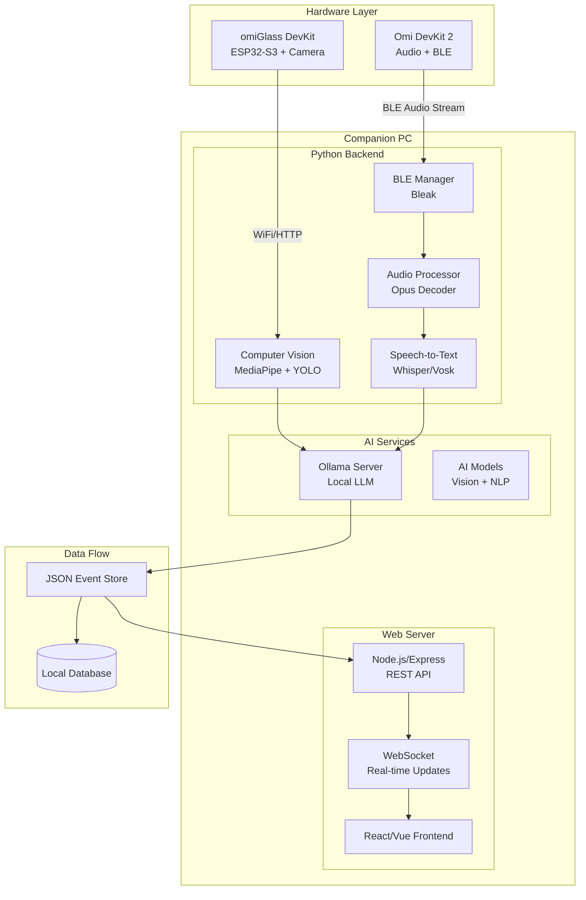
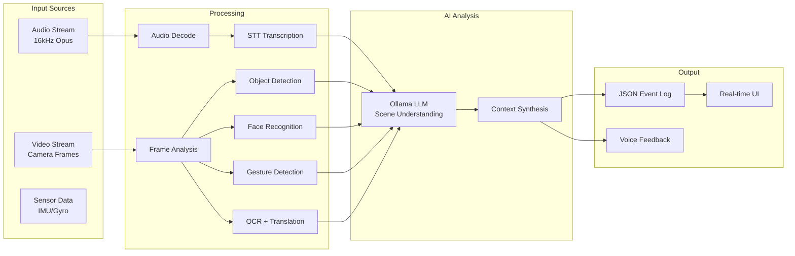
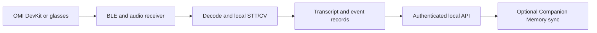

<h1 align="center">Omi Companion Capture App</h1>

<p align="center"><strong>Multi-Modal AI System Architecture for omiGlass &amp; DevKit 2</strong></p>

[](https://github.com/companionintelligence/CI-OMI/releases)
[](https://github.com/companionintelligence/CI-OMI)
[](LICENSE.md)
[](https://discord.com/invite/yQp9hwpzAa)

<p align="center"><a href="https://github.com/companionintelligence/CI-OMI">Source</a> · <a href="https://docs.ci.computer/docs/reference/open-source-systems">Systems map</a> · <a href="API_DOCUMENTATION.md">Documentation</a></p>

<p align="center">
  <a href="#implementation-checklist"></a>
</p>

### System Overview



### Data Processing Pipeline



---

## Implementation Checklist

### 1. Hardware Preparation & Setup

- [ ] **Firmware Updates**
  - [ ] Flash latest Omi firmware on DevKit 2
  - [ ] Flash latest firmware on omiGlass DevKit 
  - [ ] Verify BLE services are up-to-date with expected UUIDs
  - [ ] Test device advertising as "Omi" for discovery

- [ ] **Hardware Verification**
  - [ ] Confirm camera module integration on omiGlass
  - [ ] Test ESP32-S3 camera capture functionality
  - [ ] Verify DevKit 2 audio recording quality
  - [ ] Check all sensors (IMU, gyroscope) if applicable

- [ ] **Power & Connectivity**
  - [ ] Charge all devices to full capacity
  - [ ] Power on and verify BLE advertisement
  - [ ] Test WiFi connectivity on omiGlass
  - [ ] Confirm local network access

### 2. Development Environment Setup

- [ ] **Python Environment (Backend Core)**
  ```bash
  # Required Python packages
  pip install opencv-python mediapipe numpy pyaudio bleak
  pip install whisper torch transformers easyocr
  pip install websockets asyncio aiohttp
  ```
  - [ ] Set up Python 3.8+ virtual environment
  - [ ] Install computer vision libraries (OpenCV, MediaPipe)
  - [ ] Install audio processing (PyAudio, Opus decoder)
  - [ ] Install BLE communication (Bleak)
  - [ ] Install ML/AI libraries (Whisper, Transformers)

- [ ] **Node.js Environment (Web Server)**
  ```bash
  # Required Node.js packages
  npm install express socket.io typescript
  npm install @types/node @types/express
  npm install cors helmet dotenv
  ```
  - [ ] Initialize TypeScript project structure
  - [ ] Set up Express server with WebSocket support
  - [ ] Configure CORS for local network access
  - [ ] Implement security middleware

- [ ] **Ollama AI Server Configuration**
  - [ ] Install Ollama on local network
  - [ ] Pull required models:
    ```bash
    ollama pull moondream:1.8b-v2-fp16    # Vision-language model
    ollama pull llama3.2:3b               # General purpose LLM
    ollama pull whisper:base               # Speech recognition
    ```
  - [ ] Configure API endpoint (`http://localhost:11434/api/chat`)
  - [ ] Test model response times and performance
  - [ ] Set up model switching for different tasks

### 3. Device Connectivity Implementation

- [x] **BLE Communication Setup**
  - [x] Implement device discovery and pairing
  - [x] Connect to audio characteristic (`19B10001-E8F2-537E-4F6C-D104768A1214`)
  - [x] Subscribe to codec type characteristic (`19B10002-E8F2-537E-4F6C-D104768A1214`)
  - [x] Handle connection failures and reconnection logic
  - [x] Implement connection status monitoring

- [ ] **Audio Stream Processing**
  - [ ] Implement Opus audio decoder (16kHz, mono)
  - [ ] Create audio buffer management system
  - [ ] Verify audio integrity with test recordings
  - [ ] Implement real-time audio streaming pipeline
  - [ ] Add audio quality monitoring

- [ ] **Camera Integration**
  - [ ] Set up WiFi HTTP endpoint for frame capture
  - [ ] Implement frame request/response protocol
  - [ ] Handle different image formats and resolutions
  - [ ] Create frame buffering system
  - [ ] Add camera status monitoring

- [ ] **Sensor Data Synchronization**
  - [ ] Implement timestamp synchronization across devices
  - [ ] Create unified data stream from multiple sources
  - [ ] Handle clock drift and synchronization issues
  - [ ] Add data validation and integrity checks

### 4. Audio Processing & AI Pipeline

- [ ] **Speech-to-Text Implementation**
  - [ ] Integrate Whisper ASR for real-time transcription
  - [ ] Implement streaming audio processing
  - [ ] Add language detection and multi-language support
  - [ ] Create confidence scoring system
  - [ ] Handle background noise and audio enhancement

- [ ] **Voice Command Recognition**
  - [ ] Define command vocabulary and grammar
  - [ ] Implement wake-word detection ("Hey Omi")
  - [ ] Create command parsing and mapping system
  - [ ] Add voice feedback synthesis
  - [ ] Test command accuracy in various environments

- [ ] **Audio Event Detection**
  - [ ] Implement audio classification for environmental sounds
  - [ ] Add speaker identification and diarization
  - [ ] Create audio event logging system
  - [ ] Integrate with scene understanding pipeline

- [ ] **Audio Feedback System**
  - [ ] Implement text-to-speech for responses
  - [ ] Create audio alert system
  - [ ] Test audio playback through DevKit 2 speaker
  - [ ] Add volume control and audio quality settings

### 5. Computer Vision & AI Analysis

- [ ] **Frame Processing Pipeline**
  - [ ] Implement continuous frame capture loop
  - [ ] Add frame rate control and optimization
  - [ ] Create preview stream for web interface
  - [ ] Handle different lighting conditions
  - [ ] Implement frame quality assessment

- [ ] **Object Detection & Classification**
  - [ ] Integrate YOLO or MobileNet-SSD model
  - [ ] Implement confidence threshold filtering
  - [ ] Add bounding box and label extraction
  - [ ] Create object tracking across frames (SORT/DeepSORT)
  - [ ] Implement object counting and persistence

- [ ] **Face Detection & Recognition**
  - [ ] Implement face detection (MediaPipe or MTCNN)
  - [ ] Create face embedding database for known faces
  - [ ] Add face recognition against stored embeddings
  - [ ] Implement new face enrollment system
  - [ ] Add face tracking and re-identification

- [ ] **Emotion Analysis**
  - [ ] Integrate facial emotion recognition model
  - [ ] Add emotion confidence scoring
  - [ ] Create emotion history tracking
  - [ ] Implement emotion-based event triggers

- [ ] **OCR & Text Translation**
  - [ ] Integrate EasyOCR or Tesseract for text detection
  - [ ] Implement text region detection and extraction
  - [ ] Add text translation via Ollama LLM
  - [ ] Create text history and search functionality
  - [ ] Handle multiple languages and scripts

- [ ] **Hand & Pose Detection**
  - [ ] Implement MediaPipe Holistic for full body tracking
  - [ ] Add hand gesture recognition (peace sign, thumbs up, etc.)
  - [ ] Create pose classification (standing, sitting, etc.)
  - [ ] Implement gesture-based commands
  - [ ] Add pose-based activity recognition

- [ ] **Scene Understanding**
  - [ ] Send vision analysis to Ollama LLM for scene description
  - [ ] Implement location recognition by object context
  - [ ] Add event detection (meetings, activities)
  - [ ] Create scene-based smart triggers
  - [ ] Implement contextual memory system

### 6. Data Management & JSON Schema

- [ ] **JSON Event Schema Design**
  ```json
  {
    "timestamp": "2025-07-14T10:30:21.123Z",
    "device_id": "omi_glass_001",
    "source": "camera|microphone|sensor",
    "event_type": "object_detected|face_recognized|text_detected|gesture_detected|speech_transcribed",
    "data": {
      "object": "cat",
      "confidence": 0.92,
      "bounding_box": [x, y, w, h],
      "additional_context": {}
    },
    "location": "kitchen",
    "session_id": "uuid"
  }
  ```
  - [ ] Define comprehensive event schema
  - [ ] Add validation for all event types
  - [ ] Implement schema versioning
  - [ ] Create event aggregation rules

- [ ] **Local Storage System**
  - [ ] Implement SQLite database for event storage
  - [ ] Add JSON file backup system
  - [ ] Create data rotation and cleanup policies
  - [ ] Implement data compression for large datasets
  - [ ] Add data integrity validation

- [ ] **Network Communication**
  - [ ] Create REST API endpoints for event submission
  - [ ] Implement WebSocket for real-time updates
  - [ ] Add batch upload for network efficiency
  - [ ] Handle network failures and retry logic
  - [ ] Implement data synchronization

- [ ] **Privacy & Security**
  - [ ] Add local-only operation mode
  - [ ] Implement data encryption for sensitive information
  - [ ] Create user consent and data handling policies
  - [ ] Add secure API authentication
  - [ ] Implement data anonymization options

### 7. Web Interface Development

- [ ] **Frontend Architecture**
  - [ ] Set up React/Vue.js application
  - [ ] Implement responsive design for mobile/desktop
  - [ ] Create component library for consistent UI
  - [ ] Add TypeScript for type safety
  - [ ] Implement state management (Redux/Vuex)

- [ ] **Live Preview System**
  - [ ] Implement real-time video stream display
  - [ ] Add overlay for detection results (bounding boxes, labels)
  - [ ] Create frame rate and quality controls
  - [ ] Add zoom and pan functionality
  - [ ] Implement full-screen preview mode

- [ ] **Control Interface**
  - [ ] Create start/stop capture controls
  - [ ] Add device connection status indicators
  - [ ] Implement system health monitoring
  - [ ] Create emergency stop functionality
  - [ ] Add manual capture triggers

- [ ] **Event Logging Dashboard**
  - [ ] Create real-time event stream display
  - [ ] Add filtering and search functionality
  - [ ] Implement event detail views
  - [ ] Create data export functionality
  - [ ] Add event statistics and analytics

- [ ] **Feature Toggle System**
  - [ ] Create toggles for each AI feature (Object, Face, OCR, etc.)
  - [ ] Implement real-time feature enable/disable
  - [ ] Add performance impact indicators
  - [ ] Create feature presets and profiles
  - [ ] Add advanced configuration options

- [ ] **Settings & Configuration**
  - [ ] Create confidence threshold controls
  - [ ] Add detection interval settings
  - [ ] Implement known faces management
  - [ ] Create model selection interface
  - [ ] Add system performance monitoring

### 8. Voice Control Integration

- [ ] **Microphone Management**
  - [ ] Implement multi-source audio input handling
  - [ ] Add fallback to PC/mobile microphone
  - [ ] Create audio source switching logic
  - [ ] Implement noise cancellation
  - [ ] Add audio quality monitoring

- [ ] **Wake-Word System**
  - [ ] Integrate Porcupine or similar wake-word engine
  - [ ] Train custom wake-word model for "Hey Omi"
  - [ ] Implement wake-word confidence tuning
  - [ ] Add wake-word customization options
  - [ ] Create activation feedback system

- [ ] **Command Processing**
  - [ ] Define comprehensive command vocabulary
  - [ ] Implement natural language command parsing
  - [ ] Create command confirmation system
  - [ ] Add contextual command understanding
  - [ ] Implement command history and learning

- [ ] **UI Synchronization**
  - [ ] Ensure voice commands update web interface
  - [ ] Implement bidirectional state synchronization
  - [ ] Add voice command visual feedback
  - [ ] Create command execution status display
  - [ ] Handle command conflicts and priority

### 9. Testing & Quality Assurance

- [ ] **Unit Testing**
  - [ ] Test BLE connection stability and reconnection
  - [ ] Validate audio decoding accuracy
  - [ ] Test each AI model with known inputs
  - [ ] Verify JSON schema compliance
  - [ ] Test API endpoints and WebSocket connections

- [ ] **Integration Testing**
  - [ ] Perform end-to-end system testing
  - [ ] Test multi-device scenarios
  - [ ] Validate real-time data synchronization
  - [ ] Test network failure recovery
  - [ ] Verify cross-platform compatibility

- [ ] **Performance Testing**
  - [ ] Measure processing latency for each component
  - [ ] Test resource usage under load
  - [ ] Validate real-time performance requirements
  - [ ] Test battery life impact on devices
  - [ ] Optimize for different hardware configurations

- [ ] **Accuracy Validation**
  - [ ] Test face recognition with known/unknown subjects
  - [ ] Validate object detection accuracy
  - [ ] Test speech transcription quality
  - [ ] Verify gesture recognition reliability
  - [ ] Calibrate confidence thresholds

- [ ] **Robustness Testing**
  - [ ] Test extended operation periods (24+ hours)
  - [ ] Validate memory leak prevention
  - [ ] Test device disconnection scenarios
  - [ ] Verify graceful degradation on failures
  - [ ] Test system recovery mechanisms

### 10. Deployment & Production

- [ ] **System Configuration**
  - [ ] Create systemd services for auto-start
  - [ ] Configure startup scripts and dependencies
  - [ ] Set up logging and monitoring
  - [ ] Create backup and recovery procedures
  - [ ] Implement health check systems

- [ ] **Mobile Integration**
  - [ ] Package web app as PWA
  - [ ] Create mobile-optimized interface
  - [ ] Implement offline functionality
  - [ ] Add mobile-specific features
  - [ ] Test cross-platform compatibility

- [ ] **Data Management**
  - [ ] Set up automated backup systems
  - [ ] Create data retention policies
  - [ ] Implement cloud sync (optional)
  - [ ] Add data migration tools
  - [ ] Create data analytics pipeline

- [ ] **Maintenance & Updates**
  - [ ] Create update deployment system
  - [ ] Set up model version management
  - [ ] Implement configuration management
  - [ ] Create monitoring and alerting
  - [ ] Document operational procedures

- [ ] **Documentation & Training**
  - [ ] Create user operation manual
  - [ ] Document API and integration guides
  - [ ] Create troubleshooting guides
  - [ ] Add privacy and safety guidelines
  - [ ] Create developer documentation

---


## Features

| Feature | What it provides |
|---|---|
| **Wearable ingestion** | Receive BLE data and audio from supported OMI devices. |
| **Local media processing** | Decode audio, run speech recognition and analyze camera frames. |
| **Authenticated services** | Expose event, transcript and media APIs behind the companion service key. |

## How it fits together

The wearable sends BLE or Wi-Fi data to a companion host; audio and camera inputs are processed locally and exposed through authenticated event and media APIs.



## Architecture Components

### Core Technologies

| Component | Technology | Purpose |
|-----------|------------|---------|
| BLE Communication | Bleak (Python) | Device connectivity and audio streaming |
| Audio Processing | Opus, PyAudio, Whisper | Real-time speech transcription |
| Computer Vision | OpenCV, MediaPipe, YOLO | Multi-modal visual analysis |
| AI/LLM Backend | Ollama (Local) | Scene understanding and NLP |
| Web Server | Express.js, Socket.IO | API and real-time communication |
| Frontend | React/Vue.js, TypeScript | User interface and controls |
| Database | SQLite, JSON files | Event storage and backup |

### AI Models & Services

| Model Type | Recommended Model | Use Case |
|------------|-------------------|----------|
| Vision-Language | moondream:1.8b-v2-fp16 | Scene understanding and description |
| Speech-to-Text | whisper:base | Real-time transcription |
| Object Detection | YOLOv5/YOLOv8 | Object identification and tracking |
| Face Recognition | FaceNet, ArcFace | Person identification |
| OCR | EasyOCR, Tesseract | Text detection and extraction |
| Gesture Recognition | MediaPipe Holistic | Hand and pose detection |
| General LLM | llama3.2:3b | Text processing and analysis |

### Hardware Specifications

| Device | Component | Specification |
|--------|-----------|---------------|
| omiGlass DevKit | Processor | ESP32-S3 |
| omiGlass DevKit | Camera | Compatible camera module |
| omiGlass DevKit | Connectivity | WiFi, BLE |
| Omi DevKit 2 | Audio | 16kHz, Opus compression |
| Omi DevKit 2 | Connectivity | BLE |
| Omi DevKit 2 | Output | Built-in speaker |
| Companion PC | OS | Linux (recommended) |
| Companion PC | RAM | 8GB+ (16GB recommended) |
| Companion PC | GPU | Optional (for AI acceleration) |

### BLE Characteristics

| Characteristic | UUID | Purpose |
|----------------|------|---------|
| Audio Stream | 19B10001-E8F2-537E-4F6C-D104768A1214 | Receive audio packets |
| Codec Type | 19B10002-E8F2-537E-4F6C-D104768A1214 | Audio format information |
| Control | 19B10003-E8F2-537E-4F6C-D104768A1214 | Device control commands |
| Status | 19B10004-E8F2-537E-4F6C-D104768A1214 | Device status updates |

### API Endpoints

| Endpoint | Method | Purpose | Auth |
|----------|--------|---------|------|
| `/health` | GET | Liveness probe | none |
| `/api/events` | POST | Submit new event data | `X-API-Key` |
| `/api/events` | GET | Retrieve event history | `X-API-Key` |
| `/api/status` | GET | System status and configuration | `X-API-Key` |
| `/api/config` | PUT | Feature configuration | `X-API-Key` |
| `/api/devices` | GET | Connected device status | `X-API-Key` |
| `/ws/live` | WebSocket | Real-time updates | `X-API-Key` |

Full list, including the capture, storage, streaming and webhook routes:
[`API_DOCUMENTATION.md`](API_DOCUMENTATION.md).

### API Authentication

> **⚠️ BREAKING CHANGE for existing deployments.** Every endpoint except
> `GET /health` now requires an API key. Servers must be given one and every
> client - including anything POSTing to `/api/webhooks/*` - must be updated to
> send it.

Set `OMI_COMPANION_API_KEY` in `.env` or the server environment, and send the same
value in the `X-API-Key` header:

```bash
curl -H "X-API-Key: $OMI_COMPANION_API_KEY" http://localhost:8000/api/status
```

`./scripts/setup.sh` and `./run.sh` provision the key for you: they generate one
and write it to `.env` both when creating a fresh file and when an existing `.env`
has no `OMI_COMPANION_API_KEY` line, printing the path they wrote it to. An
existing value is never overwritten. To do it by hand, use `openssl rand -hex 32`.
See [`.env.example`](.env.example).

Config-bearing responses redact credentials: `GET /api/status` and
`PUT /api/config` report `"omi_api_key_configured": true|false` instead of the
`omi_api_key` value, so holding this service's key does not hand a caller the
upstream api.omi.me one.

**The default is closed.** With no key configured the service refuses every
guarded request with `503` rather than serving it - there is no development mode
in which the check is skipped.

---

**System Goal**: Create a comprehensive AI companion system that captures and analyzes multi-modal data (audio, video, sensors) from Omi devices, processes it through local AI models via Ollama, and provides real-time insights through a web interface. The system logs all detected **people, places, things, and events** in structured JSON format while maintaining privacy through local-only processing.

<!-- companion-hub-readme-deep-review -->

## Implementation status and data boundary

The architecture and implementation checklist in this README describe the intended end-to-end system. Use the actual setup scripts, API routes, and current repository code to confirm which device or analysis path is implemented before treating a checklist item as available.

| Boundary | Current documented behavior |
|---|---|
| Device links | omiGlass / DevKit 2 hardware and BLE characteristics are listed below |
| Local processing | Audio, vision, and model pipeline components are described in the architecture sections |
| API access | All routes except `GET /health` require an API key; the API returns `503` when no key is configured |
| Secret handling | Status/config responses redact the upstream OMI key; setup scripts preserve an existing `.env` |

Keep the API key and captured audio/video out of commits, screenshots, and issue reports. Confirm implementation status against the API and test sections before connecting a device.

